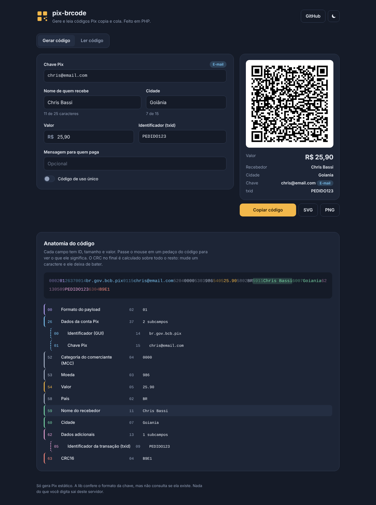
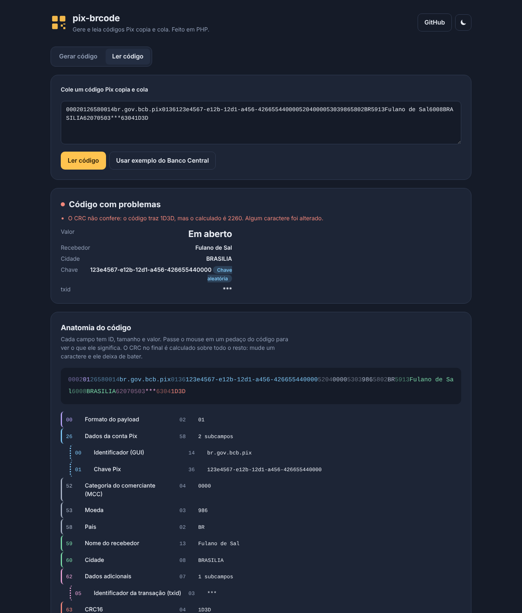

# pix-brcode

Gere, valide e leia códigos Pix (o "copia e cola" e o QR Code) em PHP, sem depender de banco nem de API.

**[Abrir a demo](https://chrisbassi.github.io/pix-brcode/)**



- Gera o **BR Code** do Pix estático seguindo o padrão do Banco Central, byte a byte igual ao exemplo do manual.
- Valida e normaliza a **chave**: CPF, CNPJ (inclusive o alfanumérico), e-mail, telefone e chave aleatória.
- **Lê** um código existente e devolve cada campo com sua posição na string, além de apontar o que está errado.
- Desenha o **QR Code** em SVG, PNG ou data URI.
- Builder imutável, PHP 8.1+, testado com PHPUnit.

## Instalação

```bash
composer require chrisbassi/pix-brcode
```

O PNG precisa da extensão GD. O SVG funciona sem ela.

## Gerar um código

```php
use ChrisBassi\PixBrCode\Pix;

$pix = Pix::static()
    ->key('chris@email.com')
    ->merchant('Chris Bassi', 'Goiânia')
    ->amount('25,90')
    ->txid('PEDIDO123')
    ->description('Pedido 123');

echo $pix->payload();   // string do copia e cola
echo $pix->qrSvg();     // <svg>...</svg>
file_put_contents('pix.png', $pix->qrPng(600));
```

```html
qrDataUri() ?>" alt="QR Code do Pix">
```

| Método | O que faz |
| --- | --- |
| `key($chave, $tipo = null)` | Detecta o tipo da chave e normaliza. Passe um `PixKeyType` para forçar o tipo. |
| `merchant($nome, $cidade)` | Remove acentos e corta nos limites do padrão: 25 caracteres no nome, 15 na cidade. |
| `amount($valor)` | Aceita `25.9`, `'25.90'` ou `'1.234,50'`. Use `null` para deixar o valor em aberto. |
| `txid($id)` | Até 25 letras e números. Sem txid, o código usa `***`. |
| `description($texto)` | Mensagem para quem paga. É cortada para caber no limite de 99 caracteres do campo 26. |
| `postalCode($cep)` | CEP opcional (campo 61). |
| `singleUse()` | Marca o código como de uso único (método de iniciação `12`). |

Cada método devolve uma cópia nova, então dá para montar uma base e variar o valor sem efeito colateral. Quando algo não passa na validação, a lib lança `InvalidPixException` com uma mensagem que diz o que corrigir.

## Ler um código

```php
$parsed = Pix::parse($codigoColado);

$parsed->isValid();       // false se o CRC não bater ou faltar campo obrigatório
$parsed->errors();        // ['O CRC não confere: o código traz 1D3D, mas o calculado é 2260. ...']
$parsed->key();           // '123e4567-e12b-12d1-a456-426655440000'
$parsed->keyType();       // PixKeyType::Evp
$parsed->amount();        // 25.9 ou null
$parsed->merchantName();
$parsed->txid();
$parsed->isDynamic();     // true quando o código traz URL (Pix dinâmico)
$parsed->fields();        // árvore de Field com id, valor e posição
```

`ParsedPix` implementa `JsonSerializable`, então `json_encode($parsed)` já devolve tudo pronto para uma API.

## Validar uma chave

```php
use ChrisBassi\PixBrCode\PixKey;

PixKey::from('529.982.247-25')->value;   // '52998224725'
PixKey::from('+55 (62) 99999-8888')->value; // '+5562999998888'
PixKey::isValid('111.111.111-11');        // false
```

A lib confere **o formato** da chave. Saber se ela está cadastrada de verdade é papel do DICT, o diretório de chaves do Banco Central, que não é público.

## Como o BR Code funciona

O código é uma sequência de campos no formato TLV do padrão EMV: **ID** com 2 dígitos, **tamanho** com 2 dígitos e o **valor**.

```
00 02 01                      formato do payload
26 58                         dados da conta Pix
   00 14 br.gov.bcb.pix       identificador
   01 36 123e4567-e12b-...    chave
52 04 0000                    categoria do comerciante
53 03 986                     moeda (real)
58 02 BR                      país
59 13 Fulano de Tal           nome de quem recebe
60 08 BRASILIA                cidade
62 07                         dados adicionais
   05 03 ***                  txid
63 04 1D3D                    CRC16
```

O último campo é um **CRC16-CCITT** (polinômio `0x1021`, início `0xFFFF`) calculado sobre tudo que vem antes, incluindo o `6304`. Basta trocar um caractere para o banco recusar o código, e é por isso que o leitor desta lib consegue dizer que um código foi adulterado.

## Demo

A pasta `demo/` tem uma interface com tema escuro e claro para gerar códigos em tempo real e ler códigos colados. A parte de baixo mostra a "anatomia" do código: cada campo pintado de uma cor, ligado à linha que explica o que ele é.



Rodando local, com o PHP do seu computador:

```bash
composer install
composer demo   # abre em http://127.0.0.1:8000 (deixe o terminal aberto)
```

### Como a demo roda no GitHub Pages

O Pages só serve arquivos estáticos e não executa PHP. Em vez de reescrever a lib em JavaScript, a versão publicada carrega o **PHP 8.3 compilado para WebAssembly** ([php-wasm](https://www.npmjs.com/package/@php-wasm/web)) e roda esta mesma lib dentro do navegador. A pasta `pages/` monta esse build com Vite, e o workflow `.github/workflows/pages.yml` publica a cada push na `main`.

```bash
cd pages
npm install
npm run dev     # mesma demo, com o PHP rodando no navegador
```

Na primeira visita o navegador baixa o runtime do PHP, então a página demora alguns segundos para gerar o primeiro código.

## Testes

```bash
composer test
```

Os testes conferem a geração contra o exemplo oficial do manual do Banco Central, a ida e volta entre gerar e ler, a detecção de CRC adulterado e a validação de cada tipo de chave.

## Limites

- Só gera **Pix estático**. Cobrança dinâmica, com vencimento e confirmação de pagamento, depende da API de um banco ou PSP com certificado e credenciais.
- O leitor entende códigos dinâmicos e mostra a URL, mas não consulta o conteúdo dela.

## Próximos passos

- [ ] Integração opcional com a API Pix de um PSP para cobranças dinâmicas.
- [ ] Componente Blade para Laravel.

## Licença

MIT
